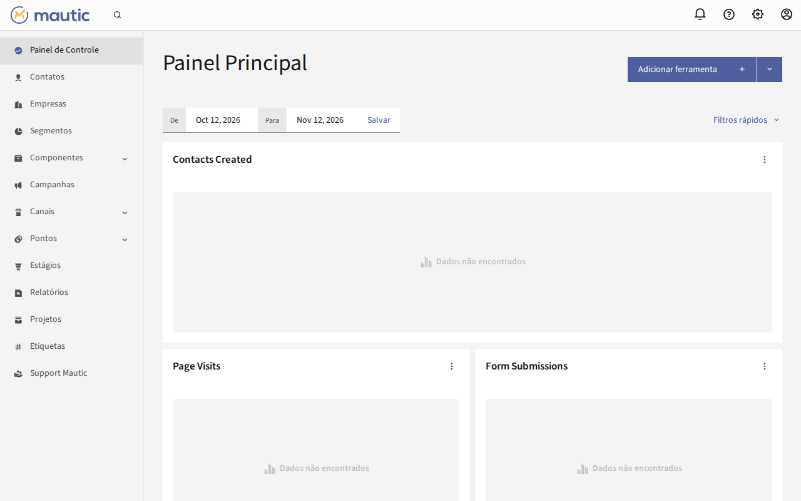
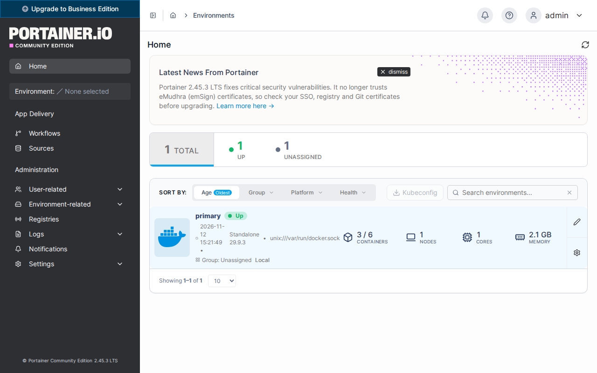
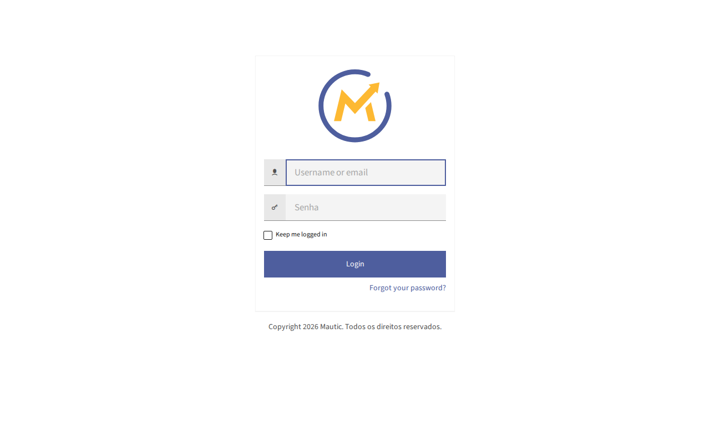

# Ensaio do teste final

Telas do ensaio feito em 12/11/2026 numa VPS de teste de 2 GB, zerada antes:
instalação do zero pelo menu, com domínio e certificado de verdade. O que foi
conferido, com os resultados, está na seção "Ensaio do teste final" do
[CLAUDE.md](../../CLAUDE.md).

Servem de referência para a gravação e para comparar depois de mudar o
visual. O instalador daquele dia ainda trazia o Traefik v3.7.16.

O domínio e o IP da máquina de teste foram trocados por exemplos
(`exemplo.com.br` e `203.0.113.10`), e as senhas foram ocultadas. Na tela de
verdade a senha aparece.

As mesmas telas, com as cores do terminal, estão em [telas.html](telas.html):
baixe o arquivo e abra no navegador.

## A primeira tela do menu

O cabeçalho é o geral, "Play Ahead Installer". A lista sai dos instaladores embutidos, e "instalado" aparece ao lado do que já existe na máquina. Aqui o menu foi aberto numa máquina que já tinha os dois.

      ────────────────────────────────────────────────────────────────────

       █▀█ █   █▀█ █ █   █▀█ █ █ █▀▀ █▀█ █▀▄
       █▀▀ █   █▀█ ▀█▀   █▀█ █▀█ █▀▀ █▀█ █ █
       ▀   ▀▀▀ ▀ ▀  ▀    ▀ ▀ ▀ ▀ ▀▀▀ ▀ ▀ ▀▀

       Play Ahead Installer                                  versão 0.1.0
      ────────────────────────────────────────────────────────────────────
       playahead.com.br   Licença MIT. Consulte o arquivo LICENSE.

       (aqui entra o aviso legal)

       Os instaladores vêm dentro deste arquivo. Nada é baixado.
         São 14909 linhas no total.

       Para ler antes de rodar, cada um começa em:
         base.sh      linha 1962
         mautic7.sh   linha 7647

       No less, digite dois-pontos, o número e Enter para pular.

       Instaladores
      ────────────────────────────────────────────────────────────────────
       1  Base       instalado   Docker, Traefik e Portainer. Uma vez por VPS.
       2  Mautic 7   instalado   Precisa da base instalada.
       0  Sair
      ────────────────────────────────────────────────────────────────────
         Para só gravar os instaladores e ler antes: --extrair

       Número da opção: 0

       Nada foi alterado nesta máquina.

## Ctrl-C numa pergunta

A base perguntou o e-mail e recebeu Ctrl-C. Ela diz que nada foi alterado, o menu avisa e volta para a lista.

       [3/7] Algumas perguntas antes de começar
       Depois daqui a instalação corre sozinha até o fim.

       O Let's Encrypt pede um e-mail para avisar sobre a
       renovação do certificado. Ele vai para a Let's Encrypt,
       não para a Play Ahead.
       E-mail para o certificado SSL: ^C
       ✗ Interrompido (Ctrl-C) em: Algumas perguntas antes de começar
         Nada foi alterado nesta máquina ainda.
         Rode de novo quando quiser.

      ────────────────────────────────────────────────────────────────────
       ! base.sh foi interrompido (Ctrl-C).
         O que já tinha sido feito continua feito; o instalador
         não desfaz nada. Rodar de novo retoma de onde dá.

       Instaladores
      ────────────────────────────────────────────────────────────────────
       1  Base       Docker, Traefik e Portainer. Uma vez por VPS.
       2  Mautic 7   Precisa da base instalada.
       0  Sair
      ────────────────────────────────────────────────────────────────────
         Para só gravar os instaladores e ler antes: --extrair

       Número da opção: 1

## Base: a confirmação e o fim

A marca > aparece só no que veio de quem instala. O quadro final fica entre duas linhas.

       [4/7] Confira antes de começar
         Swap                criar 2 GB (RAM de 1967 MB)
         Docker e Compose    instalar
         Traefik             instalar v3.7.16
       > E-mail do SSL       ci@playahead.com.br
       > Portainer           https://painel.exemplo.com.br

         > veio de você. Confira estes com atenção.

       Posso começar? [S/n]:

       [5/7] Preparando a máquina
       › Criando swap de 2 GB
         Esta máquina tem 1967 MB de RAM e nenhum swap.
         Sem swap, o Mautic corre risco de ser encerrado pelo
         sistema no meio da instalação, sem mensagem de erro.
         Registrado no /etc/fstab, para sobreviver a reboot.
       ✓ Swap de 2 GB ativo em /swapfile
       › Instalando o Docker
       Atualizando a lista de pacotes
       Instalando pré-requisitos
       Adicionando a chave e o repositório oficiais do Docker
       ✓ Chave do repositório do Docker conferida
       Atualizando a lista com o repositório do Docker
       Instalando Docker e o plugin do Compose
       Aguardando o daemon do Docker
       ✓ Aguardando o daemon do Docker: pronto em 0s
       ✓ Docker 29.9.3, Compose 5.7.1
       › Instalando o Traefik v3.7.16
       ✓ Rede traefik_public criada
       ✓ Compose gravado em /opt/playahead/traefik/docker-compose.yml
       ✓ .env gravado, com o e-mail do Let's Encrypt
       Subindo o Traefik
       Aguardando o Traefik ocupar as portas 80 e 443
       ✓ Aguardando o Traefik ocupar as portas 80 e 443: pronto em 0s
       ✓ Traefik v3.7.16 no ar

       [6/7] Portainer
       ✓ Senha do admin do Portainer gerada
       ✓ Compose gravado em /opt/playahead/portainer/docker-compose.yml
       Subindo o Portainer 2.45.3
       Aguardando o Portainer responder
       ✓ Aguardando o Portainer responder: pronto em 0s
       ✓ Portainer 2.45.3 no ar
       ✓ Credenciais gravadas em /opt/playahead/portainer/credenciais.txt
       › Conferindo se o domínio abre o Portainer
       ✓ O domínio abre o Portainer
       Conferindo o certificado de painel.exemplo.com.br ..
       ✓ Conferindo o certificado de painel.exemplo.com.br: pronto em 6s

       [7/7] Base pronta

      ────────────────────────────────────────────────────────────────────

       A infraestrutura compartilhada está no ar

       Docker          29.9.3
       Compose         5.7.1
       Rede do proxy   traefik_public
       Entrypoint      websecure
       Certresolver    letsencrypt

      ────────────────────────────────────────────────────────────────────

       Um arquivo de swap de 2 GB foi criado em /swapfile
       porque esta máquina tem pouca memória.

      ────────────────────────────────────────────────────────────────────

       Portainer

       Endereço   https://painel.exemplo.com.br
       Usuário    admin
       Senha      (oculta)

       Guardado em /opt/playahead/portainer/credenciais.txt

      ────────────────────────────────────────────────────────────────────

       Quem entra no Portainer controla todos os containers
       desta máquina. Guarde a senha num gerenciador de senhas.
       Se preferir trocar a senha do Portainer, use outra igualmente
       forte, em Minha conta (My account, no menu do usuário).

       A conferência do endereço rodou de dentro desta VPS e não
       passa pelo firewall do provedor. Abra no navegador para ter
       certeza: https://painel.exemplo.com.br

       Agora instale as ferramentas que quiser. O menu volta
       em seguida: escolha a próxima por lá.

       Quer receber avisos de novas versões, correções e conteúdos
       da Play Ahead sobre automação de marketing?
         https://playahead.com.br/avisos

      ────────────────────────────────────────────────────────────────────
       ✓ base.sh terminou.

       Instaladores
      ────────────────────────────────────────────────────────────────────
       1  Base       instalado   Docker, Traefik e Portainer. Uma vez por VPS.
       2  Mautic 7               Precisa da base instalada.
       0  Sair
      ────────────────────────────────────────────────────────────────────
         Para só gravar os instaladores e ler antes: --extrair

       Número da opção: 0

## A pergunta de versão

Feita com uma cópia do instalador em que a recomendada era a 7.2.1, para a 7.2.2 aparecer como mais nova. Enter fica na recomendada, e o "não" no fim não cria nada.

       Consultando o Docker Hub (hub.docker.com) para ver se há Mautic 7
       mais novo que o 7.2.1, a versão testada pela Play Ahead.
         Só lê a lista pública de versões; nada desta máquina é enviado.

       Qual versão do Mautic instalar?
         1  Recomendada: Mautic 7.2.1, testada pela Play Ahead
         2  Mais nova: Mautic 7.2.2, sem teste, por sua conta
       Número da opção [1]:
       ✓ Fica a versão recomendada, 7.2.1
         Existe a 7.2.2, ainda sem teste da Play Ahead.

       [4/8] Conferindo o domínio
         IP público desta máquina: 203.0.113.10
       ✓ DNS de mautic.exemplo.com.br aponta para esta VPS

       [5/8] Confira antes de começar
         Situação            instalação nova
       > Domínio             https://mautic.exemplo.com.br
       > E-mail do admin     ci@playahead.com.br
         Mautic              7.2.1 (recomendada, testada pela Play Ahead)
         DNS                 aponta para esta VPS
         Rede do Traefik     traefik_public
         Entrypoint          websecure
         Certresolver        letsencrypt
         Idioma              pt_BR
         Fuso horário        America/Sao_Paulo
         Pasta               /opt/playahead/mautic
         Conclusão           concluir pela linha de comando

         > veio de você. Confira estes com atenção.

       Posso começar? [S/n]: n

       Nada foi alterado nesta máquina.

## Mautic: a confirmação

O resumo do que vai ser feito, antes de qualquer alteração.

       [5/8] Confira antes de começar
         Situação            instalação nova
       > Domínio             https://mautic.exemplo.com.br
       > E-mail do admin     ci@playahead.com.br
         Mautic              7.2.2 (recomendada, testada pela Play Ahead)
         DNS                 aponta para esta VPS
         Rede do Traefik     traefik_public
         Entrypoint          websecure
         Certresolver        letsencrypt
         Idioma              pt_BR
         Fuso horário        America/Sao_Paulo
         Pasta               /opt/playahead/mautic
         Conclusão           concluir pela linha de comando

         > veio de você. Confira estes com atenção.

       Posso começar? [S/n]:

## Mautic: as últimas etapas e o fim

A conferência do endereço, do certificado e do cookie, e o quadro com o endereço, o e-mail e a senha.

       [7/8] Conferindo o endereço
       › Conferindo se o domínio abre o Mautic
       ✓ O domínio abre o Mautic
         terminou em https://mautic.exemplo.com.br/s/login, com 200
         depois de 2 redirecionamento(s)
       Conferindo o certificado de mautic.exemplo.com.br .
       ✓ Conferindo o certificado de mautic.exemplo.com.br: pronto em 3s
       ✓ O cookie de login sai marcado como seguro

       [8/8] Pronto

      ────────────────────────────────────────────────────────────────────

       Mautic instalado e no ar

       Endereço   https://mautic.exemplo.com.br
       Versão     Mautic 7.2.2 (recomendada, testada pela Play Ahead)
       E-mail     ci@playahead.com.br
       Senha      (oculta)

       Guardado em /opt/playahead/mautic/credenciais.txt

      ────────────────────────────────────────────────────────────────────

       Guarde num gerenciador de senhas. O arquivo não é apagado.
       Arquivos da instalação: /opt/playahead/mautic

       A conferência do endereço rodou de dentro desta VPS e não
       passa pelo firewall do provedor. Abra no navegador para ter
       certeza: https://mautic.exemplo.com.br

       ! A porta 587 está bloqueada nesta VPS.
         No Amazon SES, configure a porta 2587 no painel.
         Detalhes em /opt/playahead/mautic/credenciais.txt.

       Quer receber avisos de novas versões, correções e conteúdos
       da Play Ahead sobre automação de marketing?
         https://playahead.com.br/avisos

      ────────────────────────────────────────────────────────────────────
       ✓ mautic7.sh terminou.

       Instaladores
      ────────────────────────────────────────────────────────────────────
       1  Base       instalado   Docker, Traefik e Portainer. Uma vez por VPS.
       2  Mautic 7   instalado   Precisa da base instalada.
       0  Sair
      ────────────────────────────────────────────────────────────────────
         Para só gravar os instaladores e ler antes: --extrair

       Número da opção: 0

## Menu de novo: o Mautic já instalado

Escolher o Mautic numa máquina que já o tem não reinstala nada.

       [2/8] Conferindo a base
       ✓ Traefik encontrado: traefik-traefik-1
       ✓ Base pronta: Docker 29.9.3, Compose 5.7.1
         Traefik encontrado em traefik-traefik-1.

       Instalação encontrada
      ────────────────────────────────────────────────────────────────────
       ✓ Já existe uma instalação completa em /opt/playahead/mautic

       Nada será reinstalado e nada será apagado.

       Para reiniciar a stack:
         cd /opt/playahead/mautic && docker compose up -d

       As credenciais estão em:
         /opt/playahead/mautic/credenciais.txt

       Para levar este Mautic à versão recomendada deste
       instalador, com backup antes:
         sudo bash ./mautic7.sh --atualizar

      ────────────────────────────────────────────────────────────────────
       ✓ mautic7.sh terminou.

## Menu de novo: a base já instalada

Tela capturada no mesmo dia, depois da mudança que o ensaio motivou. Com o Portainer no ar, a base não pergunta o subdomínio outra vez: diz que ele foi encontrado e o mantém. Nenhum container foi recriado.

       [2/7] Descobrindo a situação desta máquina
       ✓ Traefik encontrado: traefik-traefik-1
       ✓ Já existe um proxy Traefik nesta máquina
         Ele será reaproveitado; nada da configuração dele será tocado.

       O que encontrei no Traefik desta máquina
      ────────────────────────────────────────────────────────────────────
       ITEM             VALOR                    ORIGEM
       rede             traefik_public           redes do container
       entrypoint       websecure                flags de linha de comando
       certresolver     letsencrypt              flags de linha de comando

       ✓ Já existe um Portainer nesta máquina
         Instalado por esta base, em https://painel.exemplo.com.br
         Ele será mantido como está; nada dele será tocado.

       [3/7] Algumas perguntas antes de começar
       Nada a perguntar desta vez.

       [4/7] Confira antes de começar
         Swap                já existe, manter
         Docker e Compose    reaproveitar 29.9.3
         Traefik             reaproveitar o que já está no ar
         Portainer           manter o que já está no ar

       Posso começar? [S/n]:

       [5/7] Preparando a máquina
       ✓ Swap já ativo nesta máquina
       ✓ Docker 29.9.3 e Compose 5.7.1 já instalados
       ✓ Traefik já existente mantido como está

       [6/7] Portainer
       ✓ Portainer já existente mantido como está
         O endereço e a senha dele estão em /opt/playahead/portainer/credenciais.txt

       [7/7] Base pronta

      ────────────────────────────────────────────────────────────────────

       A infraestrutura compartilhada está no ar

       Docker          29.9.3
       Compose         5.7.1
       Rede do proxy   traefik_public
       Entrypoint      websecure
       Certresolver    letsencrypt

      ────────────────────────────────────────────────────────────────────

       Agora instale as ferramentas que quiser. O menu volta
       em seguida: escolha a próxima por lá.

       Quer receber avisos de novas versões, correções e conteúdos
       da Play Ahead sobre automação de marketing?
         https://playahead.com.br/avisos

      ────────────────────────────────────────────────────────────────────
       ✓ base.sh terminou.

## No navegador

**O painel do Mautic depois do login.** Login feito por um navegador (Chromium, pelo Playwright) com o e-mail e a senha do `credenciais.txt`. O painel abre em português.

**O Portainer depois do login.** Entrou com a senha do `credenciais.txt`, sem pedir token de configuração.

**A tela de login do Mautic.** Aberta no domínio de verdade por um navegador que confere o certificado. Parte dela sai em inglês, por falha do pacote oficial de tradução.

